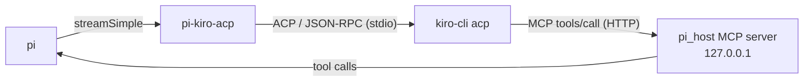

# pi-kiro-acp

Use [Kiro](https://kiro.dev) models inside the [pi](https://github.com/earendil-works/pi) coding agent.

`pi-kiro-acp` is a pi extension. It registers a `kiro-acp` model provider and drives
`kiro-cli acp` over the Agent Client Protocol (ACP). Pi stays in charge of the
conversation and the tools: Kiro only sees pi's tools, never its own built-ins.



## Features

- **Kiro as a pi provider.** Pick any Kiro model with `/model` (provider `kiro-acp`).
  The model list is discovered live from `kiro-cli`; a built-in fallback list is used
  when discovery fails.
- **Pi tools, not Kiro tools.** Pi's active tools are exposed to Kiro through an
  in-process, token-authenticated MCP server named `pi_host`. Kiro built-ins are
  excluded in the agent config and rejected at the permission gate. Tool names that
  collide with Kiro built-ins are aliased (`read` → `pi_read`).
- **Native pi tool flow.** Kiro tool calls become regular pi `toolCall` blocks, so pi
  renders, runs, and approves them as usual. Parallel calls are batched (250 ms).
- **Thinking levels.** Pi's reasoning level maps to Kiro effort
  (`low`, `medium`, `high`, `xhigh`, `max`; `off` clears it).
- **Session reuse and resume.** One `kiro-cli` process per pi session. ACP sessions
  are persisted and resumed (`session/resume`, then `session/load`) when the
  conversation history and agent config still match. Records expire after 24 hours.
- **System prompt.** Pi's system prompt is sent once per ACP session and re-sent after
  a restore or restart.
- **Usage reporting.** Context usage and credits from ACP metadata are attached to
  each turn. An optional footer shows your Kiro plan usage; `/kiro-usage` refreshes it.
- **Resilience.** Handles aborts (`session/cancel`), orphaned and late tool calls,
  empty refusals (one retry), Kiro's MCP tool-call deadline, and context-overflow
  errors (tagged `context_length_exceeded:` so pi can compact).
- **Clean shutdown.** Idle sessions (10 min) and all sessions on pi exit are stopped,
  including the `kiro-cli` process tree.

## Requirements

- [pi](https://github.com/earendil-works/pi) (`@earendil-works/pi-coding-agent`)
- [Kiro CLI](https://kiro.dev/docs/cli/) on `PATH` as `kiro-cli`, logged in

## Installation

```sh
pi install git:github.com/vantuh/pi-kiro-acp
# or from a local checkout
pi install ./pi-kiro-acp
```

Restart pi, then pick a `kiro-acp` model with `/model`.

## Models

Live discovery replaces this list when `kiro-cli` answers. The fallback list is:

`auto`, `claude-opus-5.5`, `claude-opus-5`, `claude-sonnet-5.5`, `claude-sonnet-5`,
`claude-opus-4.8`, `claude-sonnet-4.6`, `claude-haiku-4.5`, `gpt-5.6-terra`,
`gpt-5.6-luna`, `deepseek-3.2`, `minimax-m2.5`, `minimax-m2.1`, `glm-5`,
`qwen3-coder-next`.

Pi shows cost as zero; Kiro bills in credits on your plan.

## Configuration

Optional file `~/.pi/agent/kiro-acp.json`. Restart pi after editing.

```json
{
  "logger": { "debug": false, "verbose": 0 },
  "usageFooter": { "enabled": false, "pollMinutes": 10 }
}
```

| Key | Default | Meaning |
|---|---|---|
| `logger.debug` | `false` | Write `$TMPDIR/kiro-acp-debug.log` |
| `logger.verbose` | `0` | Pass `-v` to `kiro-cli acp` 0–3 times |
| `usageFooter.enabled` | `false` | Show Kiro plan usage in the footer |
| `usageFooter.pollMinutes` | `10` | Footer refresh interval |

### Environment variables

Tuning knobs; defaults work for most setups.

| Variable | Default | Meaning |
|---|---|---|
| `PI_KIRO_ACP_TOOL_BATCH_MS` | `250` | Wait for parallel tool calls before handing them to pi (`0` = no wait) |
| `PI_KIRO_ACP_REFUSAL_RETRY_MS` | `1500` | Delay before retrying an empty refusal |
| `PI_KIRO_ACP_EFFORT_COMMAND_TIMEOUT_MS` | `10000` | Timeout for applying the effort level |
| `PI_KIRO_ACP_EFFORT_REPLY_GRACE_MS` | `2000` | Grace period for the effort reply |
| `PI_KIRO_ACP_DRAIN_MS` | `150` | Drain window for trailing session updates |
| `PI_KIRO_ACP_RESTORE_LEAK_CHECK_MS` | `150` | Wait after a restore to detect a bad session (`0` = off) |
| `XDG_DATA_HOME` | `~/.local/share` | Base dir for persisted sessions |

## Commands

| Command | Description |
|---|---|
| `/kiro-usage` | Refresh Kiro plan usage shown in the footer |

## Runtime files

| What | Path |
|---|---|
| Debug log | `$TMPDIR/kiro-acp-debug.log` |
| Persisted ACP sessions | `~/.local/share/pi-kiro-acp/sessions/` |
| Agent scratch dir | `$TMPDIR/kiro-acp/agent-root-<id>` |

## Limitations

- Plan usage is not available over ACP. The footer scrapes
  `kiro-cli chat --no-interactive /usage`, which is slow and format-dependent.
- Setting effort to `off` restarts the `kiro-cli` process; Kiro cannot clear it in-band.
- The extension sets the global Kiro setting `mcp.noInteractiveTimeout` so long pi
  tool calls survive Kiro's MCP deadline.
- Effort handling relies on `kiro-cli` 2.24.1 behavior (`/effort` reply text).

## Development

No build step. Pi loads `src/index.ts` directly.

```sh
npm ci                           # install locked dependencies
npm test                         # vitest run over test/*.test.ts
npm test -- test/usage.test.ts   # selected tests
npm run lint                     # oxlint (warnings fail)
npm run format                   # oxfmt --write
npm run format:check             # oxfmt --check
npm run check                    # lint + format:check + test
```

The tests import pi's packages from the local `node_modules`, which npm fills in
from the `peerDependencies` — no global pi install is needed. Tests need an
authenticated `kiro-cli` on PATH. Files spawn real CLI processes, so Vitest runs
them one at a time.

Live end-to-end probes need an authenticated `kiro-cli`. See the
[live probe guide](test/e2e/README.md).

### Docs

- [ADR 0001: in-process HTTP MCP tool transport](docs/adr/0001-in-process-http-mcp-tool-transport.md)
- [ADR 0002: surviving Kiro's MCP tool-call deadline](docs/adr/0002-surviving-kiro-mcp-tool-call-deadline.md)
- [Debug logging](docs/DEBUG-LOGGING.md)

### Pi vs Oh My Pi

This repository is the **pi** build. An Oh My Pi (`omp`) copy lives in a separate
dotfiles tree and has diverged; changes here do not reach it. The omp copy reads
`~/.omp/agent/kiro-acp.json` and namespaces its log, persistence, and scratch dirs.

## License

[MIT](LICENSE)
