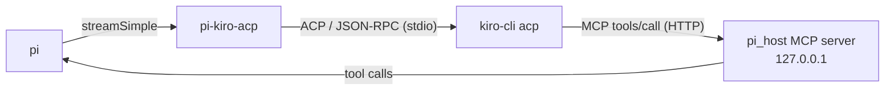

# pi-kiro-acp

Use [Kiro](https://kiro.dev) models inside the [pi](https://github.com/earendil-works/pi) coding agent.

`pi-kiro-acp` registers a native pi-ai `kiro-acp` provider and drives
`kiro-cli acp` over the Agent Client Protocol (ACP). Pi stays in charge of the
conversation and the tools: Kiro only sees pi's tools, never its own built-ins.
The same provider is reusable outside the Pi Coding Agent through the
`@vantuh/pi-kiro-acp/provider` subpath.



## Features

- **Kiro as a pi provider.** Pick any Kiro model with `/model` (provider `kiro-acp`).
  The model list is discovered live from `kiro-cli`; a built-in fallback list is used
  when discovery fails.
- **Pi tools, not Kiro tools.** Pi's active tools are exposed to Kiro through an
  in-process, token-authenticated MCP server named `pi_host`. Kiro built-ins are
  excluded in the agent config and rejected at the permission gate. Tool names that
  collide with Kiro built-ins are aliased (`read` → `pi_read`).
- **Native pi tool flow.** Kiro tool calls become regular pi `toolCall` blocks, so pi
  renders, runs, and approves them as usual. Parallel calls are batched (250 ms).
- **Thinking levels.** Pi's reasoning level maps to Kiro effort
  (`low`, `medium`, `high`, `xhigh`, `max`; `off` clears it).
- **Session reuse and resume.** One `kiro-cli` process per pi session. ACP sessions
  are persisted and resumed (`session/resume`, then `session/load`) when the
  conversation history and agent config still match. Records expire after 24 hours.
- **System prompt.** Pi's system prompt is sent once per ACP session and re-sent after
  a restore or restart.
- **Usage reporting.** Context usage and credits from ACP metadata are attached to
  each turn. An optional footer shows your Kiro plan usage; `/kiro-usage` refreshes it.
- **Resilience.** Handles aborts (`session/cancel`), orphaned and late tool calls,
  empty refusals (one retry), Kiro's MCP tool-call deadline, and context-overflow
  errors (tagged `context_length_exceeded:` so pi can compact).
- **Clean shutdown.** Idle sessions (10 min) and all sessions on pi exit are stopped,
  including the `kiro-cli` process tree.

## Requirements

- [pi](https://github.com/earendil-works/pi) (`@earendil-works/pi-coding-agent`)
- [Kiro CLI](https://kiro.dev/docs/cli/) on `PATH` as `kiro-cli`, logged in

## Installation

```sh
pi install git:github.com/vantuh/pi-kiro-acp
# or from a local checkout
pi install ./pi-kiro-acp
```

Restart pi, then pick a `kiro-acp` model with `/model`.

## Using the provider directly

The package exports a native pi-ai `Provider` with its own Kiro ACP runtime.
Hosts that register the provider import the built subpath, `dist/*.js` with its
declarations, so its `@earendil-works/pi-ai` is the host's single instance; run
`npm run build` in the checkout before installing it that way. Pi and Pi Pocket
load the TypeScript source instead.

```ts
import { createModels } from '@earendil-works/pi-ai';
import { createKiroAcpProvider } from '@vantuh/pi-kiro-acp/provider';

const provider = createKiroAcpProvider();
const models = createModels();
models.setProvider(provider);

try {
  await models.refresh({ force: true }); // discovers models from kiro-cli
  const model = models.getModels('kiro-acp')[0];
  const answer = await models.completeSimple(
    model,
    {
      messages: [{ role: 'user', content: 'Hello', timestamp: Date.now() }],
    },
    { sessionId: 'my-conversation' },
  );
} finally {
  await provider.close(); // stops every kiro-cli process it started
}
```

Pass a stable, unique `sessionId` to reuse the ACP session and its persisted
record across calls. If you omit `sessionId`, each new prompt starts a fresh ACP
session; pending tool results can still resume the session that owns them.

Auth is ambient: the provider needs no API key and has no login flow.
`kiro-cli` must be installed and authenticated. A failed discovery keeps the
built-in fallback model list.

The Pi extension registers this same provider. `session_start` binds each Pi
session to the runtime that owns it, so concurrent Pi sessions and compaction
requests stay isolated.

Persistence, recovery, cancellation, tools, and usage work for native consumers
too. Commands, the usage footer, and Pi session hooks (`context`, `message_end`,
`session_start`, `session_shutdown`) are host-adapter features and apply only
when the package runs as a Pi extension.

## Pi Pocket 0.20

Pocket loads the adapter through its two public host members,
`host.registerModelProvider` and `web.onDispose`. `host.registerModelProvider`
is experimental in Pocket 0.20. It needs Pi Pocket 0.20 or newer; an older host
gets an error that names the version. Pocket is not a dependency of this
package.

Save the module below as `kiro-acp.ts` in the data folder's `extensions/` (usually
`~/.pi-pocket/extensions/`).

```ts
/** Kiro ACP models in Pi Pocket, from a local pi-kiro-acp checkout. */
import adapter from '/path/to/pi-kiro-acp/src/pocket.ts';

export default adapter;
```

Replace the import path with your checkout. This checkout path is the tested
one. Importing `@vantuh/pi-kiro-acp/pocket` from a `node_modules` folder is not
verified. The leading comment is the module's description in the Extensions
sheet. Enable the saved module in Menu → Extensions, then select a `kiro-acp`
model.

**Availability marker, not a credential.** Native ambient providers do not need a
configured key. Pocket's legacy `ProviderConfig` bridge cannot express Kiro's
ambient CLI auth, so this adapter supplies the non-secret literal
`apiKey: "kiro-cli-ambient"` only so the provider is available. In a fresh
Pocket profile, Pi reports the source as `configured API key`. The ACP stream
does not forward this marker to `kiro-cli` (`authHeader: false`). It is not
native ambient auth and not a user key. There is no OAuth flow.

**Catalog.** The adapter seeds Pi with the native fallback list. Pi calls
`refreshModels` on every refresh, local or network. The adapter passes that
context to the native provider and returns a mutable copy of
`provider.getModels()`. A local refresh (`allowNetwork: false`) therefore keeps
the current catalog instead of emptying it. A network refresh runs the normal
`kiro-cli` discovery.

**Disposal.** One cleanup is registered before registration. It unregisters the
provider first, then awaits `provider.close()`, which stops every `kiro-cli`
process the provider owns. On a failed registration, Pocket runs that cleanup as
part of its rollback. Reload and disable start cleanup without waiting for it;
server shutdown has a shared 3-second cleanup budget.

**Working directory.** Pi tools run in the Durable session environment, where
the session cwd applies. Pocket and pi-ai do not forward a cwd to model
providers. ACP itself supports a session cwd, but this adapter receives no
per-conversation cwd. The shared provider therefore uses the server process cwd
(`process.cwd()`) for ACP sessions and persistence. Do not expect the tool cwd
and the ACP cwd to match.

**Reloads.** A reload replaces the provider and closes the old one. Draining an
active stream is not promised: a request still using the old provider can end
with a closed-provider error. Repeat the turn when that happens. A change to
imported helper code can stay cached until Pocket restarts, so restart Pocket
after such a change.

**No payload shaping, no response callback.** Pi's `onPayload` is a general
request-payload shaping callback, not an HTTP-only hook, and this ACP provider
does not implement it. The adapter also does not fabricate an HTTP response:
ACP is stdio. It does not call `onPayload` or `onResponse` and does not claim
request-shaper support (`host.shapeModelRequests` is unused).

## Models

Live discovery replaces this list when `kiro-cli` answers. The fallback list is:

`auto`, `claude-opus-5.5`, `claude-opus-5`, `claude-sonnet-5.5`, `claude-sonnet-5`,
`claude-opus-4.8`, `claude-sonnet-4.6`, `claude-haiku-4.5`, `gpt-5.6-terra`,
`gpt-5.6-luna`, `deepseek-3.2`, `minimax-m2.5`, `minimax-m2.1`, `glm-5`,
`qwen3-coder-next`.

Pi shows cost as zero; Kiro bills in credits on your plan.

## Configuration

Optional file `~/.pi/agent/kiro-acp.json`. Restart pi after editing.

```json
{
  "logger": { "debug": false, "verbose": 0 },
  "usageFooter": { "enabled": false, "pollMinutes": 10 },
  "agentEngine": "v2"
}
```

| Key | Default | Meaning |
|---|---|---|
| `logger.debug` | `false` | Write `$TMPDIR/kiro-acp-debug.log` |
| `logger.verbose` | `0` | Pass `-v` to `kiro-cli acp` 0–3 times |
| `usageFooter.enabled` | `false` | Show Kiro plan usage in the footer |
| `usageFooter.pollMinutes` | `10` | Footer refresh interval |
| `agentEngine` | `"v2"` | Engine to drive: `"v2"` or `"v3"` |

### Environment variables

Tuning knobs; defaults work for most setups.

| Variable | Default | Meaning |
|---|---|---|
| `PI_KIRO_ACP_TOOL_BATCH_MS` | `250` | Wait for parallel tool calls before handing them to pi (`0` = no wait) |
| `PI_KIRO_ACP_REFUSAL_RETRY_MS` | `1500` | Delay before retrying an empty refusal |
| `PI_KIRO_ACP_EFFORT_COMMAND_TIMEOUT_MS` | `10000` | Timeout for applying the effort level |
| `PI_KIRO_ACP_EFFORT_REPLY_GRACE_MS` | `2000` | Grace period for the effort reply |
| `PI_KIRO_ACP_DRAIN_MS` | `150` | Drain window for trailing session updates |
| `PI_KIRO_ACP_RESTORE_LEAK_CHECK_MS` | `150` | Wait after a restore to detect a bad session (`0` = off) |
| `XDG_DATA_HOME` | `~/.local/share` | Base dir for persisted sessions |
| `PI_KIRO_ACP_AGENT_ENGINE` | unset | `v2` or `v3`, overriding `agentEngine` |

### Kiro CLI V3 engine

`agentEngine` picks the engine the provider drives; `PI_KIRO_ACP_AGENT_ENGINE`
overrides the file so a launcher can switch without touching `~/.pi/agent`.
Both default to `v2`, which is the behaviour every earlier release had.

V3 (`--agent-engine=v3`) changes three things. The agent profile is written to a
temp dir and selected per session, so only the forwarded `pi_host` tools reach
the model and Kiro builtins never register. Model and effort are set in-band with
`session/set_config_option` instead of spawn flags. Steering goes through native
`_session/steer` while a tool result is still live and falls back to the
synthetic `<user_message_during_run>` block inside that tool result otherwise;
the model's `[STEERING <id>: …]` echo is stripped from its output. Probe
findings: [docs/kiro-v3-acp-probes.md](docs/kiro-v3-acp-probes.md).

## Commands

| Command | Description |
|---|---|
| `/kiro-usage` | Refresh Kiro plan usage shown in the footer |

## Runtime files

| What | Path |
|---|---|
| Debug log | `$TMPDIR/kiro-acp-debug.log` |
| Persisted ACP sessions | `~/.local/share/pi-kiro-acp/sessions/` |
| Agent scratch dir | `$TMPDIR/kiro-acp/agent-root-<id>` |

## Limitations

- Plan usage is not available over ACP. The footer scrapes
  `kiro-cli chat --no-interactive /usage`, which is slow and format-dependent.
- Setting effort to `off` restarts the `kiro-cli` process; Kiro cannot clear it in-band.
- The extension sets the global Kiro setting `mcp.noInteractiveTimeout` so long pi
  tool calls survive Kiro's MCP deadline.
- Effort handling relies on `kiro-cli` 2.24.1 behavior (`/effort` reply text).

## Development

Pi loads `src/index.ts` directly. `npm run build` emits `dist/` for the
`./provider` subpath; `npm test` runs it first.

```sh
npm ci                           # install locked dependencies
npm run build                    # tsc -p tsconfig.build.json (emits, no type check)
npm run typecheck                # tsc over src with strict checks on
npm test                         # build, then vitest run over test/*.test.ts
npm test -- test/usage.test.ts   # selected tests
npm run lint                     # oxlint (warnings fail)
npm run format                   # oxfmt --write
npm run format:check             # oxfmt --check
npm run check                    # lint + format:check + typecheck + test
```

The tests import pi's packages from the local `node_modules`, which npm fills in
from the `peerDependencies` — no global pi install is needed. Tests need an
authenticated `kiro-cli` on PATH. Files spawn real CLI processes, so Vitest runs
them one at a time.

Live end-to-end probes need an authenticated `kiro-cli`. See the
[live probe guide](test/e2e/README.md).

### Pocket probe

`test/e2e/pocket.mjs` runs the adapter inside a real Pi Pocket, through Pocket's
test helpers. It uses an isolated temporary Pocket data folder and turns its own
drop-in on and off. Only the Pocket data is isolated: `kiro-cli` uses its normal
sign-in and session store, so probe sessions appear in its session history.

```sh
# Free checks: registration, local catalog, discovery, reload ownership, disable
PI_POCKET_SOURCE=/path/to/pi-pocket KIRO_E2E_LIVE=1 node test/e2e/pocket.mjs

# Also two concurrent read turns, one warm follow-up, and one turn after a reload
PI_POCKET_SOURCE=/path/to/pi-pocket KIRO_E2E_LIVE=full node test/e2e/pocket.mjs
```

The full run makes four user turns, not four model requests: each read turn
sends at least one more request after the tool result. One warm follow-up runs
on the same provider and conversation before the second reload. It must read the
changed file again and also repeat, from conversation history, the file text
read earlier. Its prompt contains neither file text. Pocket can also
make background title requests for new conversations. Only the free run spends
no model credits.

### Docs

- [ADR 0001: in-process HTTP MCP tool transport](docs/adr/0001-in-process-http-mcp-tool-transport.md)
- [ADR 0002: surviving Kiro's MCP tool-call deadline](docs/adr/0002-surviving-kiro-mcp-tool-call-deadline.md)
- [Debug logging](docs/DEBUG-LOGGING.md)

### Pi vs Oh My Pi

This repository is the **pi** build. An Oh My Pi (`omp`) copy lives in a separate
dotfiles tree and has diverged; changes here do not reach it. The omp copy reads
`~/.omp/agent/kiro-acp.json` and namespaces its log, persistence, and scratch dirs.

## License

[MIT](LICENSE)
